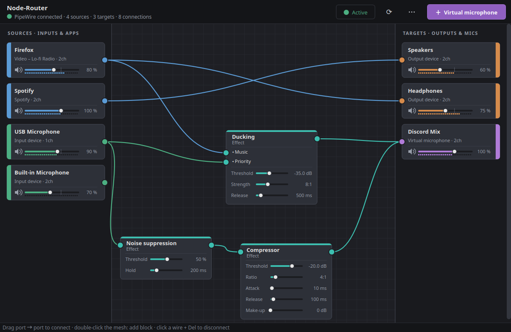

# Node-Router

A PipeWire patchbay for Linux in Node-RED style. Sources go on the left, targets on the right, and
connections and effect blocks sit in between. It can also create virtual microphones, for example
for Discord.

## Single file (AppImage)

Download `Node-Router-<version>-x86_64.AppImage` from
[Releases](https://github.com/benborofn-lgtm/Node-Router/releases), then run:

    chmod +x Node-Router-*-x86_64.AppImage     # or: right-click → Properties → Executable
    ./Node-Router-*-x86_64.AppImage

Nothing to install and no Python needed: Qt and all effect plugins (noise suppression,
compressor, ducking) are included. Settings live in `~/.config/node-router/` and effect files in
`~/.local/share/node-router/`.
To build it yourself, run `./build_appimage.sh` (it downloads PySide6, PyInstaller and appimagetool).

## Requirements

The only thing that has to come from the system is the **sound server**: PipeWire with
pipewire-pulse and WirePlumber, plus their command line tools (`pw-link`, `pactl` …). Current
desktop systems ship these preinstalled (Ubuntu 22.10 and later, Fedora 34 and later, Linux Mint 22,
Manjaro/Arch with KDE/GNOME). If something is missing, the app tells you at startup and shows the
command to fix it. Or run:

    ./install-deps.sh          # detects the distribution and asks before installing

Depending on the system, the script runs the following. Log out and back in once afterwards.

| System | Command |
|---|---|
| Ubuntu, Debian, Mint | `sudo apt install pipewire pipewire-pulse pipewire-bin wireplumber pulseaudio-utils libsndfile1 libxcb-cursor0` |
| Fedora | `sudo dnf install pipewire pipewire-pulseaudio pipewire-utils wireplumber pulseaudio-utils libsndfile xcb-util-cursor` |
| Arch, Manjaro | `sudo pacman -S --needed pipewire pipewire-pulse wireplumber libpulse libsndfile xcb-util-cursor` |
| openSUSE | `sudo zypper install pipewire pipewire-pulseaudio pipewire-tools wireplumber pulseaudio-utils libsndfile1 libxcb-cursor0` |
| all | `systemctl --user enable --now pipewire pipewire-pulse wireplumber` |

Only Ubuntu 24.04 has been tested. The other package names come from the distributions'
official repositories. The AppImage also needs glibc ≥ 2.39 (Ubuntu 24.04, Fedora 40 or newer).

## Installing from source

You need Linux with **PipeWire + pipewire-pulse** and WirePlumber, and Python ≥ 3.10.
Tested on Ubuntu 24.04 (PipeWire 1.0.5, WirePlumber 0.4.17).

    git clone https://github.com/benborofn-lgtm/Node-Router.git
    cd Node-Router
    ./install.sh                         # optional: --autostart

`install.sh` checks the system packages, creates `.venv`, installs PySide6 and adds a
"Node-Router" entry to the app menu. It does not need root. The effect plugins are already
in `plugins/` (see [plugins/README.md](plugins/README.md)). `./install.sh --uninstall` removes
the app menu and autostart entries.

To start it by hand, run `.venv/bin/python main.py`. With `--minimized` it starts in the tray only.

## Running in the background

Closing the window leaves the router running in the **tray**. The tray icon offers
Open window, Router active and Quit.

The router can only do the following while it is running:
- restore routes when an app restarts
- enforce blocked routes
- re-create virtual mics and effects after PipeWire restarts

**⋯ → Start at login** starts it automatically, minimized. Starting it a second time only
brings up the existing window.

## Usage

- Left: input devices (green) and application streams (blue).
- Right: real output devices (orange) and virtual microphones (purple).
- Drag from one port to another to connect them. To disconnect, click a wire and press Del,
  or double-click the wire.
- The two lists are fixed to the left and right window edges, with the routing area in between.
  Entries can only be dragged up or down, and the order is saved. There is no zoom and no
  horizontal scrolling.
- Right-click to add, rename or delete a virtual microphone.
- Every card has a volume slider (0–150 %, the tick marks 100 %):
  - drag it, or use the mouse wheel for ±5 %
  - double-click resets it to 100 %
  - the speaker icon mutes

  It affects the whole device or app, like pavucontrol does, not single connections.
- Below the slider, a **level meter** shows the signal peak (-60 … 0 dBFS). It turns
  yellow above -6 dBFS and red above -1 dBFS or when the signal clips. For output devices it
  shows what is being played on them. Meters only run while the window is open: a meter on a
  microphone keeps that microphone in use, so they stop when the window goes to the tray.
- **● Active / ○ Disabled** (top) turns the router off without closing it:
  - your own connections are removed and effects are stopped
  - blocked app → default speaker connections are restored
  - virtual mics stay

  Click it again to bring everything back.
- ⋯ → Theme: Dark, Light or Follow system (follows the KDE/GNOME color scheme live).
- In Discord: Settings → Voice & Video → Input Device → your virtual mic.

## Effect blocks

Double-click the routing area (or right-click → Add block) to open the block menu. It offers
**High-pass**, **Equalizer** (bass/mids/treble), **Delay**, **Reverb**, **Noise suppression**
(RNNoise), **Compressor** and **Ducking**.

- **Ducking** has two inputs. *Music* is turned down as soon as *Priority* (your mic, for example)
  crosses the threshold. The output carries the ducked music. To hear the priority signal too,
  connect it to the target directly as well; an output can have several wires.
- The plugins for noise suppression, compressor and ducking ship with Node-Router
  (see [plugins/README.md](plugins/README.md)). If one cannot be loaded, its menu entry is
  greyed out and the tooltip says why.

You can move blocks freely around the mesh and connect them like inputs and outputs
(source → block → block → target). Sliders work live. Use the mouse wheel for fine steps, and
double-click a slider to reset it to its default. Right-clicking a block lets you reset,
disconnect or remove it.

How it works: every block is its own `pipewire -c fx/<id>.conf` process, a PipeWire
filter-chain with the nodes `diy_fx_<id>_in/_out` and no autoconnect. The process keeps running
when the router is closed, and the router reuses or restarts it at the next start. Changing the
reverb's "Decay" is the only change that restarts a block. It generates a new impulse response,
so the block restarts briefly and its connections are restored automatically.

`config.json` stores virtual mics, effect blocks, your own routes, blocked routes and the order
of the lists. Routes are restored automatically when an app restarts.

### Paused apps, ignore and blocked routes

**Paused apps.** If an app or device disappears (a video is paused, for example), its card stays
in place, greyed out:
- saved connections are shown dashed and come back when it returns
- you can connect and disconnect greyed-out cards too; this changes only the saved route
- right-click → "Remove from list" removes the card, and its routes stay saved

**Ignore.** Right-click → "Ignore (never show again)" hides an app or device for good, even when
it plays sound again (libcanberra system sounds, for example). Existing connections and routes
are left as they are. To undo it, use ⋯ → Hidden → show again.

**Blocked routes.** Connections you remove are remembered as "blocked". If WirePlumber recreates
the app → speaker link (for example when the app restarts), Node-Router removes it again. That
takes about 0.2 s, so the app is briefly audible. Connecting the two again by dragging lifts the
block. This only works while the router is running.

## Tests

    .venv/bin/python tests/run_all.py            # all (about 10 minutes)
    .venv/bin/python tests/run_all.py fx ghost   # only tests whose name contains these

- **Close the router first.** Otherwise the runner aborts, because an open router would remember
  every test object in its `config.json`.
- The tests open real windows, so they need a graphical session. They also create real PipeWire
  objects: virtual test mics `diy_selftest_*`, silent test streams and effect processes.
- They use their own config in a temp folder and play nothing through the speakers.
- Afterwards the runner cleans up test leftovers. It never touches your own effect blocks
  (the ones in `config.json`).
- `test_fx_plugins` is skipped if the LSP plugins or RNNoise cannot be loaded.
- `tests/test_pipewire_restart.py --yes-really` **really** restarts PipeWire, which briefly
  interrupts the sound of every program. It checks that the mic, effect, routes and sound come back.
  It is not part of `run_all.py`; run it by hand only.

| Test | Checks |
|---|---|
| `selftest.py` | environment, reading the graph, virtual mic, connect/disconnect, GUI offscreen |
| `test_menu` | block menu: descriptions, unavailable entries, click/release |
| `test_order` | fixed lists at the window edges, sorting, resizing, no zoom |
| `test_volume` | volume slider and mute button against `wpctl` |
| `test_theme` | dark/light/system, switching without restart |
| `test_ignore` | ignoring and showing again |
| `test_ghost` | greyed-out cards, dashed routes, restoring |
| `test_blocked` | blocked routes against WirePlumber reconnecting |
| `test_power` | on/off button |
| `test_levels` | level meters: signal level, silence, hidden window, disabled router, leftovers |
| `test_background` | tray, autostart toggle, single instance, monitor restart, lost virtual mics |
| `test_deps` | system check, missing-dependency dialog, bundled plugins, libatomic fallback |
| `test_fx` | high-pass/EQ/delay/reverb: signal, sliders, moving, restart, removing |
| `test_fx_plugins` | noise suppression, compressor, ducking with two inputs |
| `test_appimage` | the built AppImage end to end (skipped without a build) |

## Known limitations

- Only tested on **Ubuntu 24.04, PipeWire 1.0.5 and WirePlumber 0.4.17**. Newer versions
  are untested, especially WirePlumber 0.5, which is configured differently. Reports from other
  distributions and versions are very welcome: please open an issue, ideally after running
  the checklist in [TESTING.md](TESTING.md).
- These only work while the router is running (use the tray or autostart):
  - restoring routes
  - blocked routes
  - re-creating mics and effects after a PipeWire restart
- When a blocked app restarts, it can be heard on the default speaker for up to about 0.3 s
  before the router removes the WirePlumber link.
- There is no volume per **connection** yet, only per device or app.

## License

GPL-3.0-or-later, see [LICENSE](LICENSE). Changes are listed in [CHANGELOG.md](CHANGELOG.md).
Want to help? See [CONTRIBUTING.md](CONTRIBUTING.md).
The bundled plugins come from other projects and keep their own licenses:
- [LSP Plugins](https://lsp-plug.in/), LGPL-3.0
- [RNNoise](https://github.com/werman/noise-suppression-for-voice), GPL-3.0
- libatomic from GCC

Details, versions and sources are in [plugins/README.md](plugins/README.md).
